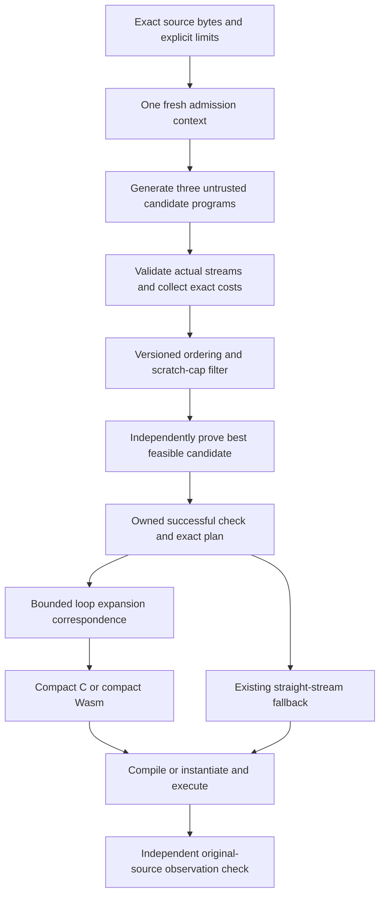

# Fast compilation architecture

Status: implemented bounded prototype; see the [implementation, final qualification and explicit target misses](../../reviews/fast-compilation/implementation/README.md). Baseline: `39dc2f6df136c643cfd030ce4470503e807750fe`. This document concerns the private Axiom compiler and the bounded public demo branded **beryl**. Lattice Core remains a separate language/compiler.

## Decision

Keep one freshly admitted compilation context, retain its successful semantic check through code generation, and preserve structured loops until the backend. Introduce candidate ranking before semantic checking under a new, explicit search policy. These changes address fresh source compilation; a cache of previously compiled user programs is not the solution being measured.

The immediate implementation remains bounded v1: at most 256 input values, the existing source family, the existing seven physical opcodes, exact checked-i32 semantics, and the existing scratch metric. A compact loop program must expand to the actual independently checked finite plan before it can be emitted. This gives a useful intermediate architecture without pretending that the blocked scalable loop-proof research has passed.

The long-term architecture has a structured domain/schedule representation and a shared scalar-expression DAG. A wholesale sea-of-nodes rewrite is not needed to fix the measured problem. Structured iteration and storage lifetimes are valuable information that the present flat stream discards early.

## What the measurements establish

The previous same-host native comparison reports 15×15 build time of 656.6 ms: selection 145.3 ms, fresh check plus C emission 123.1 ms, Clang 388.2 ms. C and Rust builds were 114.2 and 144.6 ms respectively. These are different compiler pipelines and differently structured programs, not an intrinsic language ranking. Eliminating all 268.4 ms before Clang would still leave 388.2 ms: at most about 1.69× faster overall. Frontend work alone cannot deliver the desired reduction.

Fresh diagnostic probes at the baseline, with CPython imports/runtime already loaded, found:

| Shape / scratch cap | Selected plan | Source preparation median | Wasm bytes |
| --- | --- | ---: | ---: |
| 1×1 / 64 B | inline | 5.1 ms | 267 |
| 5×7 / 64 B | two rows | 40.5 ms | 5,383 |
| 15×15 / 64 B | inline | 250.7 ms | 40,536 |
| 15×15 / 128 B | two rows | 214.7 ms | 32,924 |
| 1×127 / 1,024 B | materialize | 154.1 ms | 25,564 |
| 127×1 / 16 B | two rows | 147.0 ms | 25,585 |

Seven unprofiled samples per case follow one preparation; each preparation rebuilds the artifact. These are descriptive probes, not controlled before/after qualification. Separate cProfile runs establish call counts and relative work, with substantial instrumentation overhead. In the 15×15/64 B profile, four checker calls revisit source expressions 900 times. The internal selected-plan decode calls the strict JSON parser over 33,989 values. Repeated serialization and decoding are substantial work, not just arithmetic proof discovery.

For native emission, 15×15 inline produces 3,601 operations and 302,336 C bytes; two rows produces 2,825 operations and 200,517 C bytes. Five rotating compilation samples gave:

| Generated plan | Clang `-O1` | `-O2` | `-O3` |
| --- | ---: | ---: | ---: |
| Inline | 363.6 ms | 381.9 ms | 399.9 ms |
| Two rows | 260.5 ms | 297.7 ms | 308.5 ms |

These are throwaway flag experiments, with output checks but no kernel-throughput qualification. They do not justify changing release flags. The inline `-O3` compiler-only trace attributes 80.1 ms to frontend work and 257.2 ms to the backend, including 128.5 ms optimization and 127.1 ms code generation. Trace categories nest; do not sum overlapping totals. Linking is outside this `-c` trace. Smaller C addresses parsing, optimization and machine-code generation together.

Browser phases require separate evidence. The previous live Chromium measurement was 602.6 ms preparation at 15×15/64 B, excluding Pyodide startup; the user's approximately 875 ms observation is another device/run. CPython times cannot predict their browser. Retained browser phase measurements and their cache limitations are described in the [evidence record](../../reviews/fast-compilation/README.md).

The new browser diagnostic recorded 558.5 ms median at 15×15/64 B: selection 290.3 ms, fresh backend admission/decode/check 248.6 ms and Wasm emission 13.9 ms. Initial admission was about 1.1 ms. First distinct module preparation was 595.1 ms, with a 0.4 ms JS compile call; engine-lazy work on first execution was outside that timing. At cap 128 the full median was 517.9 ms. Five samples per case, instrumentation, one shared process and uncontrolled same-module engine caching limit these observations. They support removing duplicate frontend work before considering a replacement browser compiler.

The candidate architecture's cost model is `one admission + three generated/validated streams + one ordinary semantic proof + selected encoding + bounded correspondence + compact emission + backend`. Every term remains measured; retaining a proof does not make structural scans or correspondence free. Compared with today, the intended gains are fewer semantic passes, no internal JSON decode and a smaller backend program. Caches, lower optimization flags and a full new backend are alternatives with narrower evidence today, so they are not the first changes.

## Sources and which ideas we adopt

The [research notes](../../reviews/fast-compilation/research.md) contain seven verified primary sources and limitations. Their role is architectural precedent, not evidence of a Beryl speedup.

| Source | Adopted idea | Scope of the claim |
| --- | --- | --- |
| Halide, PLDI 2013 | Separate algorithm from schedule; retain loops/storage choices | No claim that Halide measured our cold latency |
| MLIR, 2020 preprint | Preserve structured regions and progressively lower | A small internal IR; no full MLIR dependency proposed |
| Translation validation, TACAS 1998 | Validate this compilation's actual correspondence | Validation must cover our complete semantics |
| Proof-Carrying Code, POPL 1997 | Retain explicit checked facts rather than rediscover them | Safety proof is not automatically functional equivalence |
| Alive2, PLDI 2021 | Precise arithmetic/refinement and adversarial transformation checks | Bounded validation; no unbounded-loop proof or default SMT dependency |
| V8 Liftoff, 2018 engineering report | Cheap first compilation; expensive optimization can be separate | Browser engine controls its own compilation tiers |
| Copy-and-patch, OOPSLA 2021 | Prebuilt instruction stencils as a later native-backend experiment | Target-specific engineering; no predicted Beryl speedup |

The ownership protocol, ranked checking policy and bounded correspondence migration below are our proposed design. They are not a new published theorem or validated research result.

## Architecture and trust boundaries



Two separate boundaries remain explicit:

1. Public byte/record APIs freshly admit external data. `check_plan`, `compile_wasm`, `emit_native_c` and `execute_plan` never accept a saved receipt or caller-created admitted record as authority.
2. A single internal compilation transaction can retain the fresh AST, validated immutable plan and proof it actually produced. It does not serialize the selected plan merely to decode/check it again inside that same transaction.

Proposed private interfaces, implemented in stages:

```text
_admit_compilation(source_bytes, limits) -> context
_validate_candidate(context, plan) -> owned_validated_candidate
_check_candidate(context, candidate, allowance, additional_cap) -> result
_select_compilation(context, policy, budgets) -> report + optional_owned_check
_validate_loop_correspondence(owned_check, loop_bytes, limits) -> optional_compact_artifact
_emit_checked_wasm(owned_check, optional_compact_artifact) -> WasmArtifact
_emit_checked_native_c(owned_check, optional_compact_artifact) -> NativeArtifact
```

Private Python names/frozen dataclasses are not a security boundary against hostile Python code in the same process. The invariant is that public entry points accept no authority records and the coordinator constructs/uses internal results without round-tripping through caller data. Tests must attempt forged records at every public boundary. The Worker accepts only its existing bounded request schema.

The context owns exact source bytes, parsed original AST, admitted dimensions/interval/cap/objective, immutable limits and semantics/checker identities. Candidate state owns its actual immutable operations, validated canonical size, actual metrics and canonical encoding/digest. Successful check state also binds the context identity, effective constraints, allowance/accounting version and complete checker result. Mutable scratch/SSA state is never shared between candidate checks.

Retain two plan identities: the checker uses canonical plan bytes; external artifact identity hashes the original supplied bytes, including whitespace. Internally generated canonical bytes make those identities equal only on that path. A compact artifact additionally binds structured bytes, finite-plan identity, correspondence version, backend version, target/ABI and code-generation options. Digests identify artifacts; matching digests alone never grant execution authority.

### Stage 1: retain one successful check

Refactor the existing semantic checker into an internal routine consuming fresh owned admission/validation, with unchanged public wrappers. Initially keep legacy selection order, budget behavior, attempts and outputs. The compile coordinator retains the winner's proof for emission. Encode selected bytes once for export; do not decode them internally.

Today's normal compiled path admits source seven times. Structural plan validations total six, seven or eight depending on whether one, two or three candidates are eligible, because only eligible candidates are re-encoded by selection. The new internal path should admit source once, validate each of the three actual candidates once and perform no selected-plan decode. Serialization needed by public reports/exports remains counted and bounded.

This stage deliberately does not share source-expression proofs across candidate checks. It should preserve deterministic check accounting and byte-identical C/Wasm output. It establishes a small reviewable ownership change before changing search behavior.

### Stage 2: rank actual candidates before proving them

Structural validation scans the complete stream, enforcing types, dense prior-use SSA, operation/byte quotas and bounded metadata. During the same scan, collect multiplication count and declared scratch reservation, `4 * scratch_capacity_cells`. These are the actual current ranking metrics. They are not estimates from plan labels or handwritten formulas. Structural validity does not establish initialized scratch, index bounds, output completeness or safe arithmetic.

After fresh source admission, discard only candidates conclusively violating the effective scratch cap or structurally invalid. Sort the rest by the existing tuple `(primary_metric, secondary_metric, actual_plan_id)`, stably preserving original portfolio order for an identical entire tuple. Semantically check in this order. A successful proof must agree with the structurally collected metrics before emission.

**Ordering argument.** Let `K(p)` be the exact tuple for structurally valid candidate `p`. For the first eligible candidate `p` in sorted order, every earlier candidate must be conclusively ineligible, and every later candidate has `K(q) >= K(p)`. No eligible later candidate can improve the winner; stable ties preserve the legacy complete-budget winner. Thus one successful proof suffices in the ordinary case. This argument covers this fixed generated portfolio, not all imaginable schedules.

The current default fixture has 225 outputs and 256 inputs. Its three checks use 27,901, 27,125 and 27,125 conceptual steps; the backend repeats the winner's 27,901 or 27,125. Ranked proof plus retained handoff reduces the normal sum from 110,052 to 27,901 at cap 64, or 109,276 to 27,125 at cap 128. That is about 75% fewer semantic steps, **not** a measured 4× wall-time speedup. Candidate generation/validation, encoding, correspondence and backend work remain.

**New policy contract.** Keep `select_plan` and its legacy receipts unchanged. Introduce search policy `ranked-proof-v1`; tuple ranking version 1 can stay unchanged. For its first implementation:

- The portfolio must be completely generated and structurally examined before claiming its optimum. Generation failure/cancellation/unsupported syntax produces no new artifact.
- Conclusive semantic `INVALID` proceeds to the next candidate. Every `UNKNOWN` reason during candidate generation/validation/selection/checking, checker exception or cancellation stops with no artifact; unknown is never treated as invalid. This includes structural/resource limits, unsupported constructs and inconclusive semantic comparisons, not just semantic work exhaustion. An earlier unknown cannot be silently bypassed while claiming optimality. Optional compact-hint failure after a successful selection has its separately specified finite-emission fallback below.
- Shared total budgets never reset; an exception without a work receipt conservatively consumes the call allowance. No hidden legacy retry or new budget is created.
- Reports distinguish `structurally_rejected`, `constraint_rejected`, `proved_invalid`, `proved_eligible`, `not_checked_worse_rank`, and `unknown`; skipped candidates have no semantic receipt. Include policy identity and `portfolio_optimal` only when established.
- Low budgets may produce no artifact where legacy selection preserves inline. This is an explicit policy difference. Legacy callers retain their existing fallback behavior; a future best-verified fallback would need a separately specified quality status and budget reservation.

Candidate generation/structural work is separately bounded by three candidates, existing per-plan operation/byte limits and source limits. Semantic `check_steps` must not be misreported as covering all frontend cost. Add phase counts/wall-time fields in measurement reports, not a silent change in checker accounting.

### Stage 3: keep bounded loops through code generation

Introduce a small **bounded internal** loop representation, distinct from scalable plan v2. It contains the existing primitive operations, lexical local values, literal specialized unit-step loop bounds, bounded affine indices and explicit modulo two. No loop-carried scalar values, data-dependent indices or new arithmetic transformations are needed. Carry exact scratch reservation and source specialization binding.

Have the untrusted planner retain this structure while producing the existing finite plan. An independent bounded decoder/expander must compare the entire executable operation sequence with the eligible finite plan: opcode, dense definition mapping, operand order, literal, index, ordering, operation count and scratch capacity. Reject omitted/duplicated/dead/suffix operations as well as changed visible outputs. Origins/labels remain bounded metadata and never establish acceptance. Preserve finite-plan bytes and identity for replay. Decode/expand under explicit byte, syntax-depth, integer, operation and traversal-work ceilings; reject before allocating an oversized expansion. Bound all control visits/iterations, including empty bodies and zero-trip inner loops, plus index/SSA evaluation. Syntax size and emitted-operation limits alone cannot bound such traversal. Use checked saturating cost precomputation and per-step charging under an explicit separate hint-work quota.

Current v1 ordering is authoritative for initial correspondence. Its two-row schedule stages rows 0 and 1, consumes row r, then stages row r+2. The v2 hand outline uses a different staging order and repeated constants; it is not an exact expansion witness for v1. The v1 generator hoists one constant. With O=HW and P=(H+1)(W+1), its streams have `1+16O` inline operations or `1+4P+8O` staged operations. Formulas help tests; checked actual streams remain metric authority.

Emit compact C first, followed by compact Wasm. Lower each structured primitive with the existing numeric semantics. C retains int64-first add/multiply and proved i32 conversion. Wasm retains i32 arithmetic only under proof plus complete input preflight. Use lexical locals reused across loop iterations; preserve scratch writes and reads in their validated order. Wasm preflight must also become a loop; today it is unrolled. Separately bound every actually evaluated index intermediate, loop increment and byte-address computation; a normalized in-range expression is insufficient.

Full row-major input preflight must finish before kernel scratch/output effects. Preserve first-invalid-index+1, unchanged input and initialized output on rejection, successful output coverage and arbitrary destination sentinels. Scratch is logically uninitialized even if a native allocation or a reused Wasm page contains zeros. Preserve disjoint ownership and no dependence on earlier runs. The logical scratch metric still excludes scalar locals, stack allocation and the Wasm page; report physical storage separately rather than claim a stronger memory guarantee.

A valid arbitrary finite plan without a matching hint keeps the existing straight-stream emitter. A malformed, mismatched or over-budget hint cannot authorize code; discard it and emit the already checked finite plan, with fallback reason in diagnostic measurements. Scope quotas for hint processing separately so fallback cannot reset exhausted semantic budgets. Do not pattern-match a plan label and substitute a hardcoded stencil formula.

This is still bounded enumeration and translation validation, Θ(HW) for this source family. It primarily shrinks backend input and local counts. It does not establish scalable proof or remove the 256-input boundary. Clang can unroll compact literal-bound loops again, so acceptance must measure optimized IR/object size and compiler phases, not C size alone.

### Conditional work after those stages

**Shared expression facts.** Profile again before interning/source-proof sharing: ranked checking already removes three of four source expansions. The existing arena already uses integer edges rather than recursively hashing DAGs. Further sharing must key operator/type/operands/assumptions/environment and preserve exact grouping and checked intermediate behavior. Accounting v1's `check_steps` charges conceptual source visits, physical operations and repeated equality pairs; the separate `expression_nodes` quota bounds conceptual allocations. Memoization must retain both virtual counters, quota cutpoints, failure witnesses and diagnostic precedence. Saturate cached conceptual weights at relevant quotas to avoid huge-integer work. Otherwise introduce a new accounting/checker version explicitly. This is not a prerequisite for the first release.

**Native runtime/backend.** If compact emission still misses latency targets, measure a separately compiled strict I/O host plus small kernel, then a baseline native backend. A prebuilt host/stencil library is compiler infrastructure, but its preparation, bytes, ABI/toolchain/platform key and installation cost must be reported separately. Do not subtract first-time user-program work and call it cold compilation. Copy-and-patch or a measured Cranelift experiment is an option, not an immediate dependency or rewrite commitment.

**Optimization tiers.** Keep `-O3` until measured compact-code alternatives justify another policy. Compare `-O1/-O2`, explicit unroll control and optimized variants under kernel throughput as well as process latency. If an optional optimizing tier is added, bind its version/options, retain the checked schedule and install results only for the current source epoch. Break-even is additional compile cost divided by per-run saving when that saving is positive. Bounded-demo process startup must not conceal a slower kernel.

**Incremental compilation.** Exact-source or dependency-keyed caches can help later edits, but are a separate measured mode. Keys must bind raw/semantic source, shape, constraints, objective, limits and compiler/backend identities as appropriate. Never infer a fresh proof from a user-supplied saved receipt. Do not put general SMT, equality saturation or stochastic schedule search in the latency-critical default without a demonstrated bottleneck and bounded cost.

**Scalable v2.** Existing `source_profiles.py` admits sources; it supplies no loop-plan eligibility. The research gate in `axiom/docs/loop-plan-v2.md` and `docs/reviews/loop-proof-feasibility.md` remains blocked: the full certificate is not instantiated and the conservative proposed work is 8,814,588 versus the unchanged 1,000,000 quota. Partial traces and passing research tests do not close F1. Only a complete independently reviewed certificate/charged-work result can unlock subsequent scalable checker/planner/native/oracle gates. This bounded improvement neither weakens nor bypasses that sequence.

## Performance contract and acceptance

Targets below are engineering budgets, **not achieved results or promises for the user's hardware**. Record a fresh baseline and candidate in the same serial controlled run before applying them.

| Milestone | Proposed target on fixed qualification host |
| --- | --- |
| Ownership/handoff | Byte-identical output; no internal plan decode or fourth semantic check; no >10% small-case regression |
| Ranked checking | Same full-budget portfolio winner/bytes across all 955 shapes and cap/objective corpus; ordinary path one complete proof |
| Browser after compact backend | 15×15 preparation median ≤150 ms and ≥4× below paired baseline; stretch ≤100 ms |
| Native after compact backend | 15×15 complete build median ≤250 ms and ≤2× same-run direct C/Rust builds; stretch ≤200 ms |
| Prepared execution | No >10% verified-request/process regression; measure actual kernel throughput separately, target no >10% regression |
| Representation | At least 10× smaller generated C and Wasm locals/bytes for 15×15 compact path; explain any target miss |

A miss is a measured outcome: keep the faster validated stages, report the miss and use the measured residual to choose the next experiment. Never loosen correctness, quotas or constraints to hit a timing threshold. If browser source checking still dominates, investigate bounded DAG/accounting work before another backend; if Clang dominates, investigate compact optimization/runtime/backend work.

Measure separately: app/worker/Pyodide boot, fresh-source preparation after runtime load, independent module compile/instantiate, first execution (including lazy machine-code compilation), prepared execution, input/output comparison and subsequent-source/cache reuse. Explicitly record possible browser engine reuse of identical module bytes. For native, include admission, generation/validation, semantic proof, correspondence, serialization, emission, C frontend, optimizer, machine-code generation, link and full process. Nested profiler categories must not be double-counted.

Use fresh native compiler processes for qualification cold builds. For engine-cold browser cases use a fresh browser process with a fresh temporary profile and Worker for each sample, or verified engine-cache control; a fresh Worker alone may share V8's module cache. Load runtime/imports before timing the first user program, record boot separately, and do not warm up that program. Alternate baseline/candidate serially, retain raw samples and report median/p95 with sample count. Use at least 21 measured samples for key acceptance cases, one explicitly identified warm-up only in applicable prepared/warm scopes, and record exactly which infrastructure is warm. Inputs must vary and remain unknown at compile time. Check all outputs and complete failure observations independently outside timed kernel samples. Record CPU/load, runtime/toolchain versions, flags, source/plan/loop/module hashes, selected metrics, limits/policy identities and clean revisions.

Correctness coverage includes every admitted shape/three schedules for expansion, all existing cap/objective selection contexts, 1×1/long-thin/odd-even boundaries, arbitrary valid unrecognized finite plans, renamed labels, invalid scratch lifetime, reordered scalar grouping, dead overflow, first/middle/last and multiple invalid inputs, hostile bytes/records/quotas, repeated memory reuse and cancelled/stale compilation. Execute actual C and Wasm with the existing independent original-AST evaluator and finite interpreter. Faulty but rehashed compact emitters must be detected by observation tests; the correspondence result alone does not prove that an emitter is correct.

## Rollout

Deliver small separately reviewed changes: measurement contract; owned context/handoff; ranked policy; bounded correspondence; compact C; compact Wasm; integration/qualification. Preserve legacy public APIs and straight-stream fallback throughout. Update the public module allowlist only for reviewed bounded dependencies; scalable proof research, Core bindings and recovery evidence stay private. Rebuild/review the MIT demo package before publishing under the existing authorization, preserve visible compilation costs, and verify hosted asset hashes. The original planning PR published no implementation. The subsequent implementation record documents the prototype rollout ruling and retained target misses.

The [implementation plan](../plans/2026-10-17-fast-compilation.md) defines file-level tasks and release gates.
